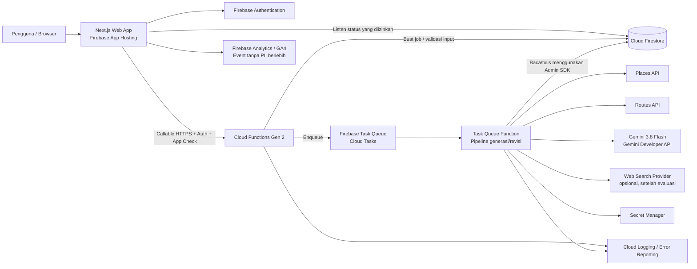

# Plesir — Dokumen Arsitektur Teknis

**Versi:** 1.1 — draft teknis untuk MVP\
**Tanggal:** 29 Oktober 2026\
**Sumber kebutuhan:** `prd.md` versi 1.2\
**Status:** Penyimpanan Firebase dan pilihan Google AI Studio dengan Gemini 3.8 Flash telah dipilih sebagai arah MVP. Penyedia data tempat/rute, wilayah deployment, pemakaian free tier untuk pengguna publik, dan anggaran masih perlu divalidasi pada Fase 0.

---

## 1. Tujuan Dokumen

Dokumen ini menjabarkan arsitektur teknis Plesir untuk memenuhi kebutuhan MVP: pengguna memasukkan kota dan rentang tanggal perjalanan, sistem mengumpulkan data tempat dari sumber yang dapat ditelusuri, AI memilih dan menyusun itinerary, rute dihitung menggunakan layanan pemetaan, serta rencana dapat diedit dan disimpan oleh pengguna yang login.

Dokumen ini juga menjelaskan fitur prompt bahasa natural untuk **merevisi itinerary**. Fitur tersebut bukan fitur yang mengizinkan pengguna atau AI mengubah source code website Plesir.

Arsitektur berpegang pada prinsip berikut:

1. **Firestore adalah penyimpanan akun dan data rencana pengguna.**
2. **AI bukan sumber fakta tempat.** Fakta harus berasal dari penyedia data atau sumber yang dapat ditelusuri.
3. **Model tidak menulis langsung ke Firestore.** Model menghasilkan keputusan terstruktur; backend memvalidasi dan menerapkan perubahan.
4. **Data penyedia hanya disimpan sesuai ketentuan lisensinya.** Place ID dapat digunakan sebagai pengenal persisten; detail dan rute harus diambil ulang jika ketentuannya mengharuskan.
5. **Pengguna dapat membuat rencana tanpa login yang terlihat.** Autentikasi anonim dapat menjadi identitas sementara untuk kepemilikan dan pembatasan penggunaan.
6. **Biaya adalah batasan desain.** Jumlah panggilan AI, Places, dan Routes dibatasi, diukur, dan dapat dikurangi dengan mode hemat.

---

## 2. Ringkasan Keputusan Arsitektur

| Area | Rekomendasi MVP | Alasan |
|---|---|---|
| Frontend | Next.js + TypeScript | Cocok untuk web responsif, halaman produk, dan alur aplikasi dalam satu codebase. |
| Hosting web | Firebase App Hosting | Dukungan framework Next.js dan integrasi dengan produk Firebase. |
| Autentikasi | Firebase Authentication: Google, email link, dan anonymous | Sesuai kebutuhan login opsional, serta mendukung sesi tamu. |
| Database | Cloud Firestore | Penyimpanan profil, rencana, revisi, feedback, dan status job. |
| Backend API | Cloud Functions for Firebase Gen 2, TypeScript | Menjaga API key dan logika tepercaya di server serta dekat dengan Firebase. |
| Proses latar belakang | Firebase task queue functions (berbasis Cloud Tasks) | Memproses generasi/revisi secara asinkron, melaporkan progres, dan menangani retry. |
| AI | **Gemini 3.8 Flash melalui Gemini Developer API**; API key dibuat di Google AI Studio dan dipakai dari backend melalui Genkit/Google Gen AI SDK | Model cepat untuk pemilihan kandidat dan revisi terstruktur. Request tetap melewati backend agar kuota, validasi, dan data pengguna dapat dikendalikan. |
| Data tempat | Google Places API (New), atau alternatif yang lolos spike data dan legal | Kandidat utama untuk pencarian dan detail tempat; cakupan Malang Raya perlu diuji. |
| Jarak dan waktu | Google Routes API, atau alternatif resmi setara | Menghitung jarak dan durasi berdasarkan moda, bukan jarak garis lurus. |
| Proteksi | Firebase App Check, validasi server, rate limit dan kuota | Mengurangi penyalahgunaan; App Check sendiri bukan pengganti rate limit. |
| Secret | Google Cloud Secret Manager / konfigurasi secret Firebase | API key penyedia dan secret tidak boleh berada di bundle browser atau repository. |
| Observabilitas | Cloud Logging, Error Reporting, Firebase/Google Analytics | Memantau latensi, error, penggunaan, dan biaya per tahap. |

### 2.1 Batas MVP

MVP sebaiknya memusatkan usaha pada:

- Satu kawasan pilot: Malang Raya.
- Rencana 1–5 hari, satu kawasan per perjalanan; durasi dihitung dari rentang tanggal.
- Form wajib hanya kota dan rentang tanggal berangkat–pulang (maksimal 5 hari).
- Empat kategori utama: penginapan, makan, kafe/kopi, dan wisata.
- Edit dasar yang deterministik: ganti, hapus, susun ulang, dan pin.
- Login opsional dan penyimpanan riwayat.
- Tautan Google Maps untuk lokasi/rute.
- Prompt bahasa natural sebagai lapisan di atas operasi edit yang sama, setelah operasi edit dasar berfungsi.

Popularitas berbasis artikel, peta mini, berbagi publik, PDF, dan dukungan banyak kota dipisahkan sebagai tahap berikutnya. Label “ramai sekarang” tidak ditampilkan tanpa sumber real-time yang sah dan jelas.

---

## 3. Diagram Arsitektur Tingkat Tinggi



### 3.1 Pembagian tanggung jawab

- **Browser** mengumpulkan input, menampilkan progres dan hasil, serta mengirim aksi pengguna. Browser tidak memegang secret penyedia data/AI.
- **Next.js** merender UI, validasi pengalaman pengguna, halaman publik, dan menginisialisasi Firebase Web SDK.
- **Callable Functions** menjadi gerbang API: autentikasi, App Check, validasi payload, pemeriksaan kepemilikan, deduplikasi, kuota, dan pembuatan job.
- **Task Queue Function** menjalankan proses yang dapat memakan waktu: pencarian data, pemilihan tempat, penyusunan rundown, kalkulasi rute, validasi, dan penyimpanan hasil.
- **Firestore** menyimpan data akun, struktur rencana, revisi yang diperlukan untuk undo, feedback, dan status job. Bukan cache bebas untuk konten penyedia.
- **Gemini 3.8 Flash** melalui Gemini Developer API menafsirkan intent, memilih di antara kandidat terverifikasi, dan menghasilkan alasan/rundown terstruktur. Genkit dapat digunakan sebagai SDK/orchestrator di backend. Model tidak membuat fakta tempat.
- **Places dan Routes API** memberi data sumber. Detail yang diminta harus dibatasi dengan field mask dan ditampilkan dengan atribusi yang diwajibkan.

---

## 4. Teknologi dan Struktur Aplikasi

### 4.1 Frontend

**Pilihan:** Next.js dengan TypeScript dan App Router.

Tanggung jawab frontend:

- Beranda dan form kota/rentang tanggal.
- Panel preferensi opsional.
- Autocomplete kota, validasi tanggal (tidak boleh lampau, pulang tidak sebelum berangkat), dan batas rentang 1–5 hari.
- Layar progres yang mengikuti status job Firestore.
- Halaman hasil: ringkasan asumsi, kategori rekomendasi, itinerary harian, sumber, peringatan, dan tautan Maps.
- Edit itinerary: ganti, hapus, susun ulang, pin, revisi natural language, dan undo.
- Login, riwayat, penghapusan, feedback, serta keadaan kosong/error/offline.

Rekomendasi implementasi frontend:

- Gunakan Firebase Web SDK modular untuk Auth dan pembacaan Firestore yang memang diizinkan oleh Security Rules.
- Gunakan skema TypeScript bersama (misalnya Zod) untuk memastikan bentuk input dan respons konsisten.
- Gunakan React Hook Form atau mekanisme serupa jika panel preferensi menjadi cukup kompleks; form utama harus tetap sederhana.
- Hindari menaruh kunci server di variabel `NEXT_PUBLIC_*`. Variabel tersebut akan terekspos ke browser.
- Jangan menganggap validasi frontend cukup. Semua batasan dan validasi bisnis diulang di backend.

### 4.2 Backend

**Pilihan awal:** Cloud Functions for Firebase Gen 2 menggunakan TypeScript.

Gunakan callable HTTPS function untuk aksi yang berasal dari aplikasi karena SDK callable dapat membawa token Auth dan App Check. Gunakan task queue function untuk proses asinkron yang lebih panjang.

Cloud Run service terpisah dapat dipertimbangkan jika kelak dibutuhkan kontrol container, concurrency, koneksi streaming, atau orkestrasi yang tidak praktis di Functions. Itu bukan keharusan untuk MVP.

### 4.3 Lokasi deployment

Pilih region Firebase/Google Cloud dengan mempertimbangkan:

- Latensi pengguna Indonesia.
- Ketersediaan Firebase Functions, Firestore, task queue, serta akses/kuota Gemini Developer API, Places, dan Routes untuk konfigurasi yang dipilih.
- Biaya transfer data dan layanan.
- Persyaratan privasi dan pemrosesan data.

Region Asia Tenggara dapat menjadi kandidat awal, tetapi **wilayah Firestore harus diputuskan sebelum membuat database produksi**. Lokasi database tidak mudah dipindah. Lakukan pengukuran dan tinjau persyaratan data sebelum keputusan final.

### 4.4 Provider dan model AI yang dipilih

Pilihan MVP adalah **Gemini 3.8 Flash melalui Gemini Developer API**.

- **Google AI Studio** dipakai untuk membuat dan mengelola API key serta menguji prompt. Aplikasi produksi tidak mengirim request ke halaman AI Studio; backend memanggil Gemini Developer API menggunakan key tersebut.
- Worker Cloud Functions memanggil model melalui Genkit dengan plugin Google AI atau Google Gen AI SDK. Pilih salah satu integrasi saat implementasi dan bungkus di service internal agar SDK dapat diganti tanpa mengubah alur produk.
- Nama model disimpan sebagai konfigurasi backend, misalnya `GEMINI_MODEL=gemini-3.8-flash`. Jangan menaruhnya di frontend atau menggunakan alias `latest` yang bisa berubah tanpa evaluasi.
- Pantau siklus hidup model dan tanggal pensiun yang diumumkan Google. Perubahan model dilakukan terencana: jalankan golden set dan evaluasi kualitas/biaya sebelum mengganti konfigurasi production.
- API key berbeda untuk development, staging, dan production. Semua key disimpan di Secret Manager/Firebase secrets dan tidak pernah dikirim ke browser.
- Gunakan structured output/JSON Schema untuk hasil itinerary dan `PlanPatch`. Backend tetap memvalidasi schema, `placeId`, kategori, jam, serta aturan rute sebelum menyimpan hasil.
- Firebase AI Logic dapat menjadi alternatif jika kelak ingin memanggil model dari web SDK, tetapi MVP tetap memakai backend sebagai gerbang agar Plesir dapat menerapkan kuota, validasi data, dan pengendalian biaya secara konsisten.

**Catatan free tier dan privasi:** Gemini Developer API menyediakan free tier untuk model/akun yang memenuhi syarat, dengan batas kuota yang dapat berubah. Ketentuan Google menyatakan data penggunaan pada layanan gratis dapat digunakan untuk meningkatkan produk Google dan mungkin ditinjau oleh manusia. Karena pengguna dapat menulis catatan bebas tentang perjalanan, free tier sebaiknya dipakai untuk prototipe/golden set dengan data uji, atau hanya untuk trafik publik setelah ketentuan, pemberitahuan privasi, dan persetujuan yang sesuai ditinjau. Jangan kirim email, UID, token, atau data pribadi yang tidak diperlukan ke model. Jika Cloud Billing ditautkan, verifikasi ketentuan billing Gemini Developer API karena penggunaan dapat beralih ke skema pay-as-you-go. Lihat Bagian 11.4.

---

## 5. Alur Utama: Membuat Rencana

### 5.1 Alur pengguna dan sistem

1. Pengguna mengisi kota dan rentang tanggal. Preferensi lain opsional.
2. Frontend memvalidasi field wajib dan mengirim permintaan ke `startPlanGeneration`.
3. Function memverifikasi Firebase Auth, App Check, bentuk payload, validasi rentang tanggal (termasuk tanggal lampau), kuota harian, dan `idempotencyKey`.
4. Function membuat dokumen job dengan status `queued`, lalu memasukkan job ke task queue.
5. Frontend menerima `jobId`, membuka layar progres, dan berlangganan ke status job milik pengguna.
6. Worker menormalisasi input serta mengisi default dari PRD. Asumsi default dibuat eksplisit pada hasil.
7. Worker menentukan cakupan pencarian, lalu mengambil kandidat dari Places untuk kategori yang dibutuhkan.
8. Worker memfilter hasil yang tidak layak, menduplikasi kandidat berdasarkan Place ID, dan meminta detail hanya untuk kandidat yang relevan.
9. AI memilih dan menyusun rencana dari kandidat yang diberikan, dengan output JSON sesuai schema.
10. Validator server memeriksa identitas kandidat, kategori, sumber, durasi, batas jumlah aktivitas, jam buka yang tersedia, dan aturan itinerary.
11. Routes API menghitung estimasi rute untuk urutan final dan moda yang dipilih.
12. Validator menghitung jadwal, buffer, total perjalanan, dan memastikan tempat yang diketahui tutup tidak dijadwalkan.
13. Worker menyimpan struktur rencana dan menandai job `completed` atau `partial`.
14. Frontend menerima perubahan melalui listener Firestore dan menampilkan hasil.

### 5.2 Status job

Contoh status yang dapat digunakan:

```text
queued
normalizing_input
searching_places
enriching_places
selecting_candidates
building_itinerary
calculating_routes
validating_plan
saving_plan
completed
partial
failed
cancel_requested
cancelled
```

Tahap yang tampil kepada pengguna harus berupa label produk yang jelas, bukan nama internal API. Status internal dapat lebih rinci daripada indikator visual. Persentase progres hanya ditampilkan jika bermakna; jangan membuat persentase semu yang selalu naik tanpa hubungan dengan pekerjaan nyata.

### 5.3 Pembatalan dan retry

- Frontend dapat meminta pembatalan dengan mengubah status job melalui endpoint tepercaya.
- Worker memeriksa flag pembatalan di batas-batas tahap. Pekerjaan eksternal yang sudah berjalan mungkin tidak dapat dihentikan seketika.
- Worker harus idempotent. Retry task tidak boleh membuat beberapa plan duplikat atau menagih pemrosesan ulang tanpa pemeriksaan.
- Simpan `attemptCount`, kode error terstandar, dan `updatedAt`; jangan simpan stack trace atau secret di dokumen yang bisa dibaca klien.
- Atur jumlah retry dan concurrency maksimum pada task queue berdasarkan anggaran dan batas provider.

---

## 6. Alur AI dan Grounding

### 6.1 Pembagian tugas

**Bukan tugas LLM:**

- Menentukan apakah tempat benar-benar ada.
- Mengarang alamat, koordinat, rating, jumlah ulasan, jam buka, harga, jarak, waktu tempuh, atau status buka.
- Menganggap sebuah tempat tersedia untuk dipesan.
- Menulis langsung ke Firestore.

**Tugas LLM:**

- Menafsirkan catatan dan preferensi pengguna.
- Memilih kandidat dari daftar yang diberikan backend.
- Mengelompokkan aktivitas ke hari dan mengusulkan urutan.
- Menghasilkan alasan singkat yang sesuai dengan data kandidat dan preferensi.
- Menafsirkan prompt revisi menjadi operasi terstruktur yang dibatasi.

### 6.2 Pipeline yang disarankan

1. **Normalize:** isi default (2 dewasa, tempo santai, mobil, jam 08.00–21.00, dan lainnya) dan simpan daftar asumsi yang dipakai.
2. **Discover:** cari kandidat kategori dalam area yang relevan. Jaga radius, jumlah query, jumlah kandidat, dan field mask agar biaya terkendali.
3. **Enrich:** ambil detail hanya yang diperlukan untuk kandidat terpilih/pertimbangan final.
4. **Filter:** buang tempat yang terindikasi tutup permanen; tandai data yang tidak ada atau tidak terverifikasi.
5. **Select:** minta Gemini memilih berdasarkan `placeId` dari allowlist kandidat.
6. **Route:** hitung rute berdasarkan moda dan urutan yang dipilih.
7. **Schedule:** susun jam dan durasi dengan aturan deterministik aplikasi, slot makan, buffer, batas aktivitas, dan jam buka yang tersedia.
8. **Validate:** tolak atau koreksi output yang melanggar schema dan aturan bisnis.
9. **Explain:** hasilkan alasan yang tidak menambahkan klaim faktual baru.
10. **Persist:** simpan identitas tempat yang diizinkan, struktur itinerary, dan penyesuaian pengguna.

### 6.3 Skema output AI

Output AI wajib mengikuti JSON Schema yang dikontrol aplikasi dan divalidasi kembali di server. Contoh konseptual:

```json
{
  "summary": "Rencana santai untuk 3 hari di Malang Raya.",
  "assumptions": ["2 dewasa", "moda mobil", "tempo santai"],
  "selectedPlaces": [
    {
      "placeId": "ID_YANG_SUDAH_ADA_DI_ALLOWLIST",
      "category": "attraction",
      "day": 1,
      "order": 2,
      "reason": "Berada dekat dengan aktivitas lain hari ini."
    }
  ],
  "warnings": ["Jam buka belum terverifikasi untuk tanggal perjalanan."]
}
```

`placeId` di atas harus cocok dengan hasil kandidat backend. Setiap ID asing, atribut factual baru, kategori tak dikenal, atau aktivitas yang melanggar aturan harus ditolak atau diminta ulang.

### 6.4 Penilaian dan kepercayaan

Peringkat kandidat sebaiknya merupakan gabungan logika server yang dapat diuji dan pemilihan AI. Faktor yang dapat dipakai: kecocokan preferensi, kualitas dengan penyesuaian jumlah ulasan, kedekatan klaster, keragaman, kesesuaian harga jika diketahui, kelayakan jam buka, dan status operasional.

Simpan penanda keyakinan berdasarkan kelengkapan/keandalan sumber, bukan “tingkat percaya diri” yang hanya dikarang model. Jika data kurang, UI menyatakannya dengan jelas.

---

## 7. Fitur Prompt untuk Merevisi Itinerary

### 7.1 Batas fitur

Prompt ditujukan untuk **mengubah rencana perjalanan**, bukan mengedit file, komponen React, konfigurasi deployment, atau database secara bebas.

Contoh intent tahap awal:

- “Ganti tempat wisata hari kedua dengan alternatif yang lebih dekat.”
- “Cari pilihan makan yang lebih hemat.”
- “Kurangi aktivitas hari pertama.”
- “Pindahkan kafe ke sore.”
- “Jangan ubah hotel dan tempat yang sudah saya pin.”

Batasi intent awal ke operasi yang bisa divalidasi. Jika prompt meminta hal yang tidak didukung, jelaskan kemampuan yang tersedia atau ajukan pertanyaan.

### 7.2 Alur revisi

1. Frontend mengirim `planId`, teks prompt, `expectedVersion`, dan `idempotencyKey` ke `revisePlan`.
2. Backend mengecek identitas, kepemilikan, versi plan, kuota, batas panjang prompt, dan App Check.
3. Backend mengambil rencana serta kandidat yang relevan. Jika permintaan butuh alternatif baru, backend mencari data Places dahulu.
4. Gemini menerima konteks minimum dan menghasilkan `PlanPatch` terstruktur.
5. Backend memvalidasi bahwa operasi hanya mengenai hari/aktivitas yang ada dan kandidat pengganti berasal dari allowlist.
6. Backend mempertahankan item yang di-pin dan menerapkan kebijakan “ubah bagian yang terdampak”.
7. Routes API dan scheduler menghitung ulang jarak, waktu, dan jadwal pada hari/leg yang terdampak.
8. Backend melakukan commit menggunakan kontrol versi/transaction agar perubahan tidak menimpa edit bersamaan.
9. Backend menyimpan revisi yang cukup untuk Undo, menaikkan `version`, memperbarui plan, dan menyelesaikan job.
10. UI menampilkan hasil terbaru, ringkasan perubahan, dan tombol Undo.

### 7.3 Bentuk patch konseptual

```json
{
  "intent": "replace_activity",
  "operations": [
    {
      "op": "replace",
      "dayId": "day-2",
      "activityId": "activity-7",
      "replacementPlaceId": "CANDIDATE_PLACE_ID"
    }
  ],
  "preservePinned": true,
  "affectedDays": ["day-2"],
  "needsClarification": false
}
```

Model hanya mengusulkan patch. Kode server memutuskan apakah patch valid dan menjalankan perubahan. Prompt tidak boleh menjadi Firestore update path atau query yang dieksekusi langsung.

### 7.4 Preview, penerapan otomatis, dan undo

- Operasi tunggal yang jelas (misalnya mengganti satu tempat) dapat diterapkan langsung setelah validasi, lalu disediakan Undo.
- Permintaan ambigu, perubahan besar, atau perubahan yang menghapus banyak item sebaiknya meminta klarifikasi atau konfirmasi.
- Simpan perubahan app-owned: item sebelum/sesudah, urutan, status pin, catatan pengguna, versi, waktu, dan sumber aksi.
- Jangan membuat snapshot permanen dari semua data Place Details untuk keperluan Undo jika ketentuan penyedia melarang penyimpanan tersebut.

---

## 8. Peta, Tempat, dan Rute

### 8.1 Places API

Gunakan Places API (New) untuk pencarian kandidat, autocomplete, dan detail yang memang diperlukan. Tentukan field mask sesempit mungkin: setiap field tambahan dapat memengaruhi SKU/biaya.

Perhatikan hal berikut:

- Atribusi/logo Google dan atribusi pihak ketiga harus mengikuti kebijakan untuk cara data ditampilkan.
- Jam buka, rating, jumlah ulasan, harga, harga kamar, dan status dapat tidak tersedia atau berubah.
- Places tidak sama dengan sistem pemesanan hotel. Jangan menjanjikan harga/ketersediaan kamar tanpa sumber yang sesuai.
- Daftar kandidat perlu diuji manual di Malang Raya untuk akurasi nama, kategori, status, dan kelengkapan data.

### 8.2 Routes API

Gunakan Routes API untuk rute sesuai moda. Bila itinerary harian sudah memiliki urutan, hitung rute untuk urutan tersebut dan ambil jarak/durasi yang diperlukan. Gunakan Route Matrix hanya saat memang perlu membandingkan beberapa kombinasi kandidat; matrix memiliki biaya berdasarkan jumlah elemen.

- Gunakan Place ID jika didukung agar waypoint lebih jelas.
- Tampilkan nilai sebagai estimasi dan cantumkan moda serta waktu pemeriksaan bila relevan.
- Jika hanya tersedia jarak garis lurus, jangan menampilkannya sebagai jarak berkendara.
- Jangan menyimpan hasil rute jangka panjang sebelum aturan penyimpanan Route API diverifikasi.

### 8.3 Google Maps URLs

Tautan lokasi dan rute dapat dibuat dengan format resmi Google Maps URLs. Tautan Maps tidak menggantikan Routes API: URL Maps untuk navigasi pengguna, Routes API untuk estimasi jarak/waktu yang ditampilkan di Plesir.

- Buat URL secara server/client dari identitas tempat dan urutan itinerary yang tersedia.
- Encode nama/parameter dengan benar.
- Periksa batas waypoint dan pecah rute menjadi beberapa bagian bila melebihi batas dokumentasi saat implementasi.
- Uji tautan di browser desktop dan perangkat mobile, baik dengan aplikasi Maps maupun web.

---

## 9. Model Data Firestore

Model berikut bersifat konseptual. Field akhir harus disesuaikan dengan hasil spike dan ketentuan tiap penyedia.

### 9.1 Profil pengguna

```text
users/{uid}
  createdAt: Timestamp
  updatedAt: Timestamp
  displayName?: string
  email?: string
  authProviders: string[]
  accountState: "active" | "deletion_pending"
```

Simpan data profil minimum. Jangan menyalin password; Firebase Auth mengelola kredensial.

### 9.2 Rencana

```text
users/{uid}/plans/{planId}
  ownerUid: string
  title: string
  destination:
    displayName: string
    cityId?: string
    regionLabel?: string
  durationDays: number
  travelStartDate: string
  travelEndDate: string
  preferences: object
  assumptions: string[]
  selectedBasePlaceId?: string
  itineraryVersion: number
  status: "ready" | "partial" | "refresh_required"
  createdAt: Timestamp
  updatedAt: Timestamp
  lastCheckedAt?: Timestamp
  lastJobId?: string
  deletedAt?: Timestamp
```

Struktur itinerary dapat disimpan sebagai subcollection agar mudah diedit per hari:

```text
users/{uid}/plans/{planId}/days/{dayId}
  dayNumber: number
  activityIds: string[]
  estimatedStart?: string
  estimatedEnd?: string
  userNotes?: string

users/{uid}/plans/{planId}/activities/{activityId}
  placeId: string
  category: string
  order: number
  pinned: boolean
  userNote?: string
  reason?: string
```

Jangan memasukkan semua field hasil Places/Routes ke dokumen plan secara default. Simpan struktur yang dimiliki aplikasi/pengguna dan identitas tempat yang diizinkan; ambil detail terkini dari provider saat ditampilkan atau disegarkan.

### 9.3 Job generasi/revisi

```text
users/{uid}/planJobs/{jobId}
  ownerUid: string
  type: "generate" | "revise" | "refresh"
  planId?: string
  status: string
  stage: string
  progress?: number
  requestId: string
  inputSummary: object
  errorCode?: string
  createdAt: Timestamp
  updatedAt: Timestamp
  expiresAt: Timestamp
```

Jangan menaruh API key, raw provider response berlebihan, token auth, atau stack trace di job document. Terapkan masa kedaluwarsa pada job/metadata sementara jika sesuai kebutuhan.

### 9.4 Revisi/undo

```text
users/{uid}/plans/{planId}/revisions/{revisionId}
  versionBefore: number
  versionAfter: number
  operationSummary: string
  beforePatch: object
  afterPatch: object
  createdAt: Timestamp
  source: "manual" | "natural_language" | "refresh"
```

Revisi menyimpan perubahan yang diperlukan untuk memulihkan struktur itinerary milik aplikasi, bukan snapshot konten penyedia yang tidak boleh disimpan.

### 9.5 Data tambahan

- `usage/{uid}/daily/{dateKey}`: hitungan dan batas pemakaian; hanya backend yang dapat mengubah.
- Feedback dapat disimpan pada subcollection per plan atau collection khusus dengan metadata minimum.
- Event analitik utama sebaiknya dikirim ke Firebase/Google Analytics tanpa email, prompt mentah, atau informasi pribadi yang tidak diperlukan.
- Fitur share belum menjadi fokus Must. Jika ditambahkan, gunakan token acak berentropi tinggi, hak akses read-only, expiry/revocation, dan jangan memakai `planId` sebagai token rahasia.

---

## 10. Autentikasi, Akses Tamu, dan Rules

### 10.1 Metode autentikasi

- Google Sign-In.
- Email link/passwordless sesuai konfigurasi Firebase Authentication.
- Firebase Anonymous Authentication untuk sesi tamu yang memiliki identitas server-side.

Identitas anonim adalah detail implementasi; dari perspektif produk pengguna tetap dapat membuat rencana tanpa login atau membuat password.

### 10.2 Migrasi rencana tamu

Saat tamu login:

1. Jika kredensial dapat ditautkan ke identitas anonim saat ini, hubungkan provider ke UID yang sama.
2. Jika pengguna ternyata masuk ke akun yang sudah ada, gunakan endpoint backend khusus untuk memindahkan rencana tamu yang telah diverifikasi ke akun tersebut.
3. Migrasi harus menggunakan bukti kepemilikan sesi tamu, idempotency, dan penanda satu kali agar pengguna tidak dapat mengklaim rencana milik UID lain.
4. Setelah berhasil, hapus/arsipkan data anonim sesuai aturan retensi.

### 10.3 Prinsip Firestore Security Rules

- Pengguna hanya dapat membaca dokumen di bawah UID miliknya.
- Job hanya dapat dibaca pemiliknya; client tidak dapat mengubah status/progres job.
- Plan, usage, revision, dan feedback ditulis melalui backend tepercaya kecuali ada alasan kuat untuk mengizinkan write langsung terbatas.
- Semua operasi Admin SDK harus memeriksa token Firebase Auth dan kepemilikan secara eksplisit karena Admin SDK melewati Security Rules.
- Rules harus diuji dengan Firebase Emulator Suite: tamu, pengguna login, pengguna lain, dan request tanpa token.

App Check melindungi endpoint dari sebagian request klien tidak sah, tetapi tidak mencegah pengguna asli melakukan spam. Tetap terapkan kuota, rate limit, validasi, deteksi pola abnormal, dan proteksi biaya.

---

## 11. Pengendalian Biaya dan Kuota

Plesir gratis bagi pengguna, sehingga layanan backend perlu memiliki anggaran per plan dan anggaran bulanan.

### 11.1 Batas per permintaan

Tetapkan batas konfigurasi yang dapat diubah tanpa rilis aplikasi, antara lain:

- Kota/kawasan yang didukung pada pilot.
- Durasi maksimum 5 hari.
- Jumlah query kategori dan radius pencarian.
- Maksimum kandidat per kategori.
- Jumlah Place Details yang diambil.
- Maksimum token/context AI dan jumlah panggilan model.
- Maksimum aktivitas per hari.
- Jumlah perhitungan rute per generasi/revisi.
- Batas generasi, revisi, refresh, dan feedback per pengguna/per hari.
- Batas yang lebih ketat untuk akun anonim.

Angka final ditetapkan setelah mengukur biaya nyata pada golden set. Jangan menetapkan nominal API berdasarkan asumsi lama; tinjau pricing/sku terbaru saat Fase 0.

### 11.2 Cara menekan biaya

- Gunakan field mask hanya untuk atribut yang benar-benar ditampilkan/diperlukan.
- Ambil kandidat secukupnya dan detail hanya untuk kandidat terpilih.
- Hitung rute setelah urutan aktivitas terbentuk, bukan untuk seluruh kandidat.
- Lakukan revisi hanya pada bagian terdampak.
- Batasi prompt/revision context dan jangan mengirim seluruh riwayat percakapan yang tidak relevan.
- Untuk MVP, mulai dengan satu model (`gemini-3.8-flash`) agar kualitas, biaya, dan perilakunya mudah dievaluasi. Uji model yang lebih hemat untuk intent sederhana hanya jika golden set menunjukkan hasilnya tetap memadai.
- Gunakan cache hanya untuk data yang memang diizinkan oleh perjanjian provider. Jangan menganggap cache Firestore otomatis diperbolehkan.
- Buat alarm biaya dan mode hemat yang mengurangi detail/query serta memperketat kuota sebelum layanan berhenti.

### 11.3 Cache dan syarat data

Kebijakan Places umumnya melarang penyimpanan konten API kecuali pada pengecualian yang dinyatakan. Place ID merupakan pengecualian yang dapat disimpan; syarat untuk koordinat dan data lain perlu diperiksa secara spesifik. Routes API juga memiliki kebijakan penyimpanan tersendiri.

Karena itu:

- Jangan menyimpan permanen rating, ulasan, jam buka, harga, status, foto, koordinat, atau rute sebelum dasar lisensinya dikonfirmasi.
- Simpan Place ID dan data yang dibuat pengguna/struktur itinerary jika diperbolehkan.
- Terapkan TTL dan penghapusan otomatis untuk data sementara yang boleh di-cache dengan batas waktu.
- Pastikan atribusi tampil sesuai kebijakan ketika data disajikan.
- Jika kebijakan provider tidak cocok dengan riwayat yang diperlukan PRD, evaluasi provider dengan hak persistensi yang sesuai sebelum peluncuran.

### 11.4 Free tier dan billing Gemini Developer API

Google AI Studio adalah tempat developer membuat/mengelola API key dan mencoba prompt. Request aplikasi dikirim ke **Gemini Developer API**, bukan ke UI AI Studio.

- Free tier tersedia untuk model/akun yang memenuhi syarat, tetapi kuota dan model yang tersedia dapat berubah. Perlakukan free tier sebagai fasilitas prototipe, bukan kapasitas produksi atau jaminan uptime.
- Free tier Gemini API membatasi jumlah request/token dalam periode tertentu. Jika kuota habis atau rate limit tercapai, API dapat menolak request; backend harus menangani error tersebut dengan pesan yang jelas, retry terbatas, dan tanpa membuat biaya berulang.
- Menurut ketentuan layanan gratis Google, input dan output dapat digunakan untuk meningkatkan produk Google dan dapat ditinjau oleh manusia. Jangan mengirim email, UID, token, informasi pembayaran, atau data sensitif pengguna ke model. Prompt bebas untuk produksi memerlukan peninjauan ketentuan, kebijakan privasi, dan pemberitahuan pengguna.
- Jika Cloud Billing ditautkan ke Gemini Developer API, penggunaan dapat masuk ke skema pay-as-you-go. Sebelum menghubungkan billing, periksa konsekuensinya dan pasang budget alert, kuota aplikasi, serta pembatasan jumlah prompt.
- Pada tier berbayar, penanganan data mengikuti ketentuan berbayar yang berlaku; tinjau Terms terbaru sebelum memutuskan untuk mengirim data pengguna.
- Gunakan API key/proyek berbeda untuk development, staging, dan production. Jangan menggunakan key pribadi developer untuk website publik.
- Untuk beta publik, gunakan free tier hanya jika batas kapasitas dan implikasi data sudah diterima secara eksplisit. Jika tidak, gunakan tier berbayar pada provider/model yang sama, dengan kuota dan anggaran bulanan yang ketat.

---

## 12. Keamanan dan Privasi

### 12.1 Keamanan teknis

- Kunci Places, Routes, dan Gemini Developer API (dibuat melalui Google AI Studio) berada di Secret Manager/Firebase secrets atau mekanisme secret terkelola.
- Restrict API key berdasarkan API, project, dan lingkungan; jangan memasukkan secret server ke JavaScript browser.
- Wajibkan Auth dan App Check pada endpoint yang memulai operasi berbiaya.
- Validasi schema, panjang prompt, kategori, ID, durasi, dan ukuran payload di backend.
- Gunakan idempotency key untuk mencegah duplikasi saat pengguna mengulang request atau task di-retry.
- Terapkan version check/optimistic concurrency ketika menyimpan revisi plan.
- Batasi concurrency worker dan waktu request berdasarkan kebutuhan serta anggaran.
- Perlakukan hasil pencarian web sebagai data tidak tepercaya. Jangan menganggap isi halaman sebagai instruksi model; minimalkan konten yang masuk ke prompt dan isolasi konteksnya.
- Hindari menampilkan detail error internal kepada pengguna.

### 12.2 Privasi

- Simpan email dan profil dasar dari provider login saja, sesuai kebutuhan.
- Tidak meminta GPS pada MVP.
- Jangan mencatat prompt mentah, email, token, atau alamat IP mentah di log analitik.
- Jangan menyertakan email/UID Firebase atau data akun ke prompt Gemini. Kirim hanya data itinerary minimum yang diperlukan. Penggunaan free tier harus mengikuti catatan data handling pada Bagian 11.4.
- Jika alamat IP diperlukan untuk mitigasi penyalahgunaan, gunakan pemrosesan minimum, masa retensi terbatas, dan/atau hash berkunci; tinjau dasar pemrosesan privasinya.
- Sediakan kebijakan privasi, penghapusan rencana, penghapusan riwayat, dan penghapusan akun.
- Rancang penghapusan meliputi Firestore, subcollection, token share, data antrean yang relevan, serta proses backup sesuai kebijakan retensi dan ketentuan hukum.
- Tinjau kewajiban UU Pelindungan Data Pribadi dengan pihak yang memahami konteks hukum sebelum beta publik.

---

## 13. API Internal Konseptual

Nama berikut contoh kontrak, bukan kode final. Semua endpoint berbiaya harus memeriksa autentikasi, App Check, kuota, dan payload.

| Aksi | Fungsi konseptual | Perilaku |
|---|---|---|
| Buat rencana | `startPlanGeneration` | Validasi input, deduplikasi request, buat job, enqueue task, kembalikan `jobId`. |
| Revisi natural language | `revisePlan` | Cek owner/version, buat job revisi, enqueue task, kembalikan `jobId`. |
| Edit manual | `applyPlanEdit` | Ganti/hapus/susun ulang/pin; validasi lalu hitung ulang bagian terdampak. |
| Undo | `undoPlanRevision` | Terapkan patch sebelumnya jika versi masih sesuai; hitung ulang rute bila perlu. |
| Refresh data | `refreshPlan` | Ambil ulang data terkini yang diizinkan dan perbarui waktu pemeriksaan. |
| Batalkan | `cancelPlanJob` | Tandai job cancel; worker berhenti pada checkpoint berikutnya. |
| Hapus plan | `deletePlan` | Cek owner, hapus/revoke share dan data anak sesuai kebijakan. |
| Transfer plan tamu | `claimGuestPlans` | Verifikasi UID anonim sumber dan user tujuan; transfer satu kali. |
| City autocomplete | `suggestDestination` | Mengembalikan pilihan kota/kawasan; proxy backend bila perlu membatasi key/quota. |

Untuk semua request perubahan plan, gunakan `expectedVersion` dan tangani konflik dengan meminta UI refresh atau menggabungkan perubahan yang aman.

---

## 14. Penanganan Error dan Degradasi

| Kondisi | Perilaku sistem |
|---|---|
| Kota tidak dikenal/ambigu | Minta pengguna memilih area yang didukung sebelum job mahal berjalan. |
| Rentang tanggal di luar 1–5 hari atau tanggal lampau | Validasi di frontend dan backend; tidak enqueue job. |
| Kandidat tidak cukup | Tampilkan hasil parsial, jelaskan kategori yang kurang, tawarkan memperluas area atau mengubah preferensi. |
| Places gagal | Retry terbatas; gunakan hasil parsial hanya jika ada data yang masih valid dan diperbolehkan. Jangan mengarang fallback. |
| Routes gagal | Tandai jarak/waktu tidak tersedia; jangan menggantinya dengan jarak jalan lurus tanpa label yang jelas. |
| AI menghasilkan JSON tidak valid | Retry terkontrol sekali dengan schema/error; jika gagal, hentikan bagian tersebut atau gunakan fallback deterministik. |
| AI memilih Place ID asing | Tolak pilihan tersebut dan validasi ulang; jangan tampilkan fakta dari ID yang tidak dikenal. |
| Tempat diketahui tutup | Jangan jadwalkan untuk tanggal/hari tersebut; jika tanggal tidak diketahui, tampilkan keterbatasan pemeriksaan. |
| Kuota tercapai | Beri pesan batas yang jelas dan waktu kapan pengguna dapat mencoba lagi. |
| Gemini rate limit/kuota atau kapasitas sementara tercapai | Tangani error 429/kapasitas, retry terbatas dengan jeda, lalu beri tahu pengguna untuk mencoba lagi. Jangan retry tanpa batas atau fallback ke tier berbayar tanpa kebijakan anggaran yang eksplisit. |
| Worker gagal | Tandai job gagal dengan kode yang dapat ditindaklanjuti; retry sesuai kebijakan task queue dan cegah duplikasi. |
| Pengguna offline | Pertahankan data form lokal bila aman, tampilkan status offline, dan jangan membuat klaim job berhasil. |
| Hasil provider stale | Tampilkan waktu pemeriksaan dan opsi refresh sesuai batas penggunaan. |

---

## 15. Observabilitas dan Analitik

### 15.1 Logging dan metrik backend

Log terstruktur per `requestId`, `jobId`, dan tahap pipeline, tanpa secret atau data pribadi berlebihan. Metrik minimum:

- Latensi per tahap dan latensi total.
- Jumlah sukses, parsial, gagal, dan timeout per provider.
- Jumlah kandidat per kategori dan jumlah yang lolos validasi.
- Jumlah retry, job duplikat yang dicegah, dan pembatalan.
- Token/panggilan model serta perkiraan biaya per plan.
- Panggilan Places/Routes dan biaya estimasi per SKU jika metrik tersedia.
- Penggunaan kuota, rate limit, dan deteksi lonjakan.
- Frekuensi hasil tanpa jam buka/harga/rating.

### 15.2 Event produk

Selaraskan dengan PRD, antara lain:

- `form_started`, `form_submitted`.
- `plan_generated`, `plan_failed` dengan latensi dan kode error.
- `recommendation_opened`, `recommendation_replaced`, `recommendation_removed`.
- `revision_requested`, `revision_applied`, `revision_undone`.
- `maps_link_clicked`.
- `usage_limit_reached`.
- `login_started`, `login_completed`, `history_opened`.
- `feedback_submitted`, `data_issue_reported`.

Jangan masukkan email, prompt teks lengkap, alamat pengguna, atau informasi sensitif ke properti analytics.

---

## 16. Pengujian dan Evaluasi

### 16.1 Test otomatis

- Unit test untuk default input, scoring kandidat, scheduler, aturan jam aktivitas, dan pembuatan Maps URL.
- Unit test untuk schema output AI dan validator patch.
- Test integrasi provider dengan mock/fixture; jangan membuat test rutin yang menimbulkan biaya API produksi.
- Firebase Emulator Suite untuk Auth, Firestore Rules, Functions, job dan task queue.
- Test kepemilikan: pengguna A tidak dapat membaca, mengubah, menghapus, atau mengklaim plan pengguna B.
- Test idempotensi: retry request/task tidak membuat plan/revisi ganda.
- Test concurrency: dua edit terhadap versi yang sama tidak saling menimpa diam-diam.
- Test end-to-end untuk mobile dan desktop: form → progres → hasil → edit → Maps → riwayat.
- Test aksesibilitas untuk keyboard, label, kontras, fokus, dan screen reader dasar.

### 16.2 Golden set

Siapkan minimal 30 skenario Malang Raya dari PRD, mencakup:

- Kota/rentang tanggal dan input minimal.
- Satu hingga lima hari.
- Tanggal kerja/akhir pekan bila tersedia.
- Preferensi keluarga, alam, kuliner, halal, vegetarian, level harga, moda, dan titik awal.
- Lokasi yang tutup, data tempat tidak lengkap, hasil ambigu, dan provider gagal.
- Prompt revisi sederhana, ambigu, konflik dengan item pin, dan permintaan yang tidak didukung.

Audit manusia terhadap nama, alamat, status, sumber, kelayakan waktu/rute, dan alasan. Target akurasi PRD harus dihitung dari sampel yang definisinya jelas, bukan dari penilaian model saja.

---

## 17. Deployment dan Lingkungan

### 17.1 Lingkungan

Gunakan project Firebase/Google Cloud terpisah untuk:

- `development` — emulator dan pengembangan lokal.
- `staging` — integrasi penyedia dan uji beta tertutup.
- `production` — pengguna publik.

Jangan memakai database atau key produksi untuk test lokal. Atur budget alert dan quota API pada setiap project.

### 17.2 Pipeline rilis

1. Pull request menjalankan lint, typecheck, unit test, dan rules test.
2. Deploy preview/staging untuk review produk dan golden set.
3. Perubahan Security Rules diuji terpisah sebelum deploy.
4. Deploy Functions dan konfigurasi queue dengan kontrol versi.
5. Deploy frontend melalui Firebase App Hosting/GitHub integration.
6. Jalankan smoke test untuk login, create plan, revise, dan membuka Maps URL.
7. Pantau error, biaya, latensi, dan usage limit setelah rilis.
8. Sediakan prosedur rollback untuk aplikasi dan prompt/schema AI.

### 17.3 Prompt dan konfigurasi

Prompt sistem, schema output, jumlah kandidat, batas kuota, serta aturan scoring harus memiliki versi. Simpan versi prompt/schema pada metadata job agar hasil dapat diaudit. Jangan menyimpan secret di file prompt atau repository.

---

## 18. Tahapan Implementasi yang Disarankan

### Fase 0 — Discovery dan spike

- Uji Places API untuk empat kategori di Malang Raya.
- Verifikasi field yang tersedia: status, jam, rating, harga/level harga, dan jenis tempat.
- Verifikasi biaya Places, Routes, Gemini Developer API, Functions, Firestore, dan task queue untuk satu plan realistis.
- Tinjau aturan cache, atribusi, tampilan, dan penyimpanan dari seluruh penyedia.
- Uji Gemini 3.8 Flash pada golden set, termasuk kualitas Bahasa Indonesia, structured output, latensi, biaya, dan perilaku revisi.
- Tinjau free-tier data handling dan putuskan apakah free tier hanya dipakai untuk prototipe atau layak untuk pilot publik dengan pemberitahuan privasi yang sesuai.
- Pastikan Gemini Developer API/model tersedia dan kuota proyek cukup untuk spike; buat key terpisah untuk environment.
- Pilih region deployment untuk Firebase/Firestore dan layanan Google Cloud yang memang memiliki pilihan region.
- Bangun golden set awal dan tentukan kriteria akurasi.

**Gate:** jangan lanjut ke beta tertutup maupun rilis publik sebelum data, lisensi, biaya per rencana, dan batas penggunaan dinilai layak.

### Fase 1 — Vertical slice prototipe

- Form minimal kota + rentang tanggal.
- Pipeline generate satu rencana end-to-end.
- Status progres di Firestore.
- Hasil 4 kategori, satu itinerary harian atau multi-hari sesuai durasi, data sumber, disclaimer, dan Maps URLs.
- Security Rules, Auth tamu, dan monitoring dasar.

### Fase 2 — Pengeditan dan akun

- Ganti/hapus/susun ulang/pin.
- Rerouting dan penjadwalan ulang untuk bagian terdampak.
- Login Google dan email link.
- Riwayat, duplikat, rename, delete, dan transfer rencana tamu.
- Undo dan test akses kepemilikan.

### Fase 3 — Prompt revisi beta

- Mulai dari beberapa intent prompt terkontrol.
- Output JSON Patch tervalidasi dan pencatatan revisi.
- Uji kasus ambigu, harga tak tersedia, data minim, lokasi pin, konflik versi, dan batas biaya.
- Perluas hanya jika metrik relevansi dan biaya per revisi memenuhi target.

### Fase 4 — Closed beta dan rilis MVP

- Uji dengan 50–100 pengguna sebagaimana indikasi PRD.
- Pantau activation, P90, Maps open rate, biaya per plan, akurasi data, serta laporan informasi salah.
- Audit sampel mingguan dan rilis perubahan prompt/schema bertahap.
- Aktifkan mode hemat dan prosedur incident/rollback.

---

## 19. Keputusan Terbuka

Keputusan berikut perlu ditutup sebelum produksi:

1. Apakah Google Places dan Routes memenuhi cakupan, aturan penyimpanan, dan anggaran pilot?
2. Apakah free tier Gemini Developer API dapat digunakan untuk pilot publik setelah evaluasi privasi, atau production perlu menggunakan tier berbayar? Provider/model awal sudah dipilih: Google AI Studio/Gemini Developer API dengan `gemini-3.8-flash`.
3. Region Firestore dan Functions mana yang memenuhi latensi, ketersediaan, biaya, serta kebutuhan privasi?
4. Batas penggunaan harian untuk tamu, akun login, revisi prompt, dan refresh data.
5. Masa retensi anonymous account, job, revisi, feedback, log, dan backup.
6. Apakah harga penginapan akan ditampilkan? Jika ya, dari penyedia mana dan dengan hak penggunaan apa?
7. Sumber web mana yang sah untuk sinyal “banyak dibicarakan”? Karena statusnya Should, fitur dapat ditunda.
8. Apakah prompt revisi langsung menerapkan semua operasi aman atau selalu menampilkan preview? Rekomendasi: langsung untuk operasi kecil yang jelas, preview untuk perubahan besar/ambigu.
9. Sumber pendanaan operasional layanan gratis.

---

## 20. Jika yang Dimaksud adalah Mengedit Source Code Website

Fitur “masukkan prompt lalu website langsung mengubah source code project” tidak tercakup dalam PRD Plesir dan berisiko tinggi jika dijalankan langsung di produksi. Jika kelak memang dibutuhkan, rancang sebagai produk/fitur terpisah:

- Prompt menghasilkan patch terbatas pada representasi desain atau komponen yang diizinkan, bukan akses filesystem bebas.
- Jalankan preview di sandbox terisolasi tanpa credential produksi.
- Tampilkan diff dan preview sebelum publish.
- Simpan revisi/version dan sediakan rollback.
- Validasi serta build/test hasil sebelum perubahan dipublikasikan.
- Pisahkan izin editor dari akses ke data pengguna dan secret backend.

Untuk Plesir sesuai PRD saat ini, makna yang disarankan adalah **prompt mengedit itinerary pengguna**, bukan source code website.

---

## 21. Referensi Teknis Resmi

Dokumentasi dan ketentuan dapat berubah; verifikasi ulang sebelum implementasi produksi.

- [Firebase App Hosting](https://firebase.google.com/docs/app-hosting)
- [Firebase Authentication — email link](https://firebase.google.com/docs/auth/web/email-link-auth)
- [Firestore Security Rules](https://firebase.google.com/docs/firestore/security/get-started)
- [Verifikasi ID token Firebase di backend](https://firebase.google.com/docs/auth/admin/verify-id-tokens)
- [Firebase App Check untuk custom backend](https://firebase.google.com/docs/app-check/custom-resource-backend)
- [Firebase task queue functions](https://firebase.google.com/docs/functions/task-functions)
- [Firestore pricing](https://firebase.google.com/docs/firestore/pricing)
- [Genkit](https://genkit.dev/docs/)
- [Google AI Studio / Gemini API key](https://ai.google.dev/gemini-api/docs/api-key)
- [Gemini 3.8 Flash model](https://ai.google.dev/gemini-api/docs/models/gemini-3.8-flash)
- [Gemini model versions and lifecycle](https://docs.cloud.google.com/gemini-enterprise-agent-platform/models/model-versions)
- [Gemini structured output](https://ai.google.dev/gemini-api/docs/structured-output)
- [Gemini Developer API pricing and free tier](https://ai.google.dev/gemini-api/docs/pricing)
- [Gemini API terms and data use](https://ai.google.dev/gemini-api/terms)
- [Gemini API rate limits](https://ai.google.dev/gemini-api/docs/rate-limits)
- [Places API overview](https://developers.google.com/maps/documentation/places/web-service/overview)
- [Places API policies and attribution](https://developers.google.com/maps/documentation/places/web-service/policies)
- [Google Maps Platform Service Specific Terms](https://cloud.google.com/maps-platform/terms/maps-service-terms)
- [Places API pricing/usage](https://developers.google.com/maps/documentation/places/web-service/usage-and-billing)
- [Routes API overview](https://developers.google.com/maps/documentation/routes/overview)
- [Routes API usage and billing](https://developers.google.com/maps/documentation/routes/usage-and-billing)
- [Google Maps URLs](https://developers.google.com/maps/documentation/urls/get-started)
- [Google Cloud Secret Manager](https://cloud.google.com/secret-manager/docs/overview)
